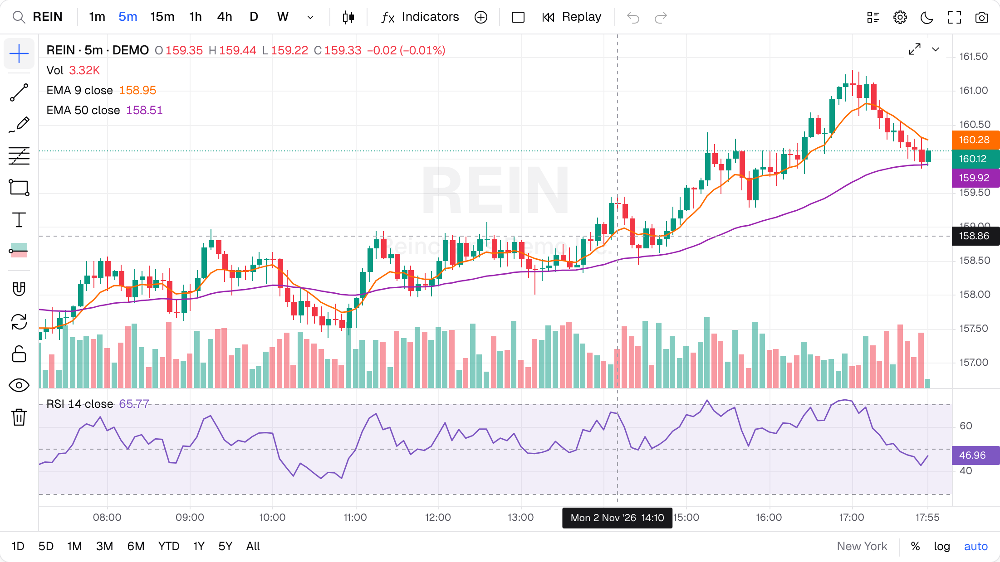

<p align="center">
  <picture>
    <source media="(prefers-color-scheme: dark)" srcset="packages/docs/public/logo-dark.png">
    
  </picture>
</p>

# Reincharts

**Interactive, canvas-rendered charts for React.** Fast, typed, themeable, MIT licensed.



- **Interactive by default**: pan, zoom, pinch, kinetic scrolling, keyboard shortcuts, crosshair, tooltips and legends that toggle series. Charts can sync with each other.
- **General charts**: line, area, stacked area, vertical, grouped, stacked and horizontal bars, scatter, bubble and error bars, on numeric, time or category axes.
- **Annotations and drawings**: reference lines and areas, markers, labels, plus ~30 drawing tools with undo/redo, magnet mode and JSON save/load.
- **Layouts**: resizable panes, multiple value scales, log, percent and indexed scales, and light and dark themes.
- **Financial charts too**: candlesticks, OHLC, Heikin Ashi, Renko, Kagi, Point & Figure, volume profile, 30+ indicators, a datafeed adapter and a batteries-included `<TradingChart>` widget.
- **Fast and small**: one render loop and two canvases. Only what is visible gets drawn, and there are no runtime dependencies besides React.

## Install

Install only the packages you use:

```bash
npm i @reincharts/core @reincharts/series @reincharts/axes @reincharts/coordinates @reincharts/tooltip
```

```tsx
import { XAxis, YAxis } from "@reincharts/axes";
import { Crosshair } from "@reincharts/coordinates";
import { ChartCanvas } from "@reincharts/core";
import { LineSeries } from "@reincharts/series";
import { Tooltip } from "@reincharts/tooltip";

export function Chart({ data }) {
  return (
    <ChartCanvas data={data} height={360}>
      <LineSeries y="value" />
      <YAxis />
      <XAxis />
      <Crosshair />
      <Tooltip />
    </ChartCanvas>
  );
}
```

Or install everything at once with the umbrella package: `npm i reincharts`.

## Documentation

Guides, live examples and the API reference are at **https://reincharts.com**.

## Packages

| Package                   | Description                                             |
| ------------------------- | ------------------------------------------------------- |
| `reincharts`              | Everything below in one package                         |
| `@reincharts/core`        | Engine, `<ChartCanvas>`, `<Pane>`, scales, theme, hooks |
| `@reincharts/series`      | Chart types                                             |
| `@reincharts/indicators`  | Indicator calculators and `<Indicator>`                 |
| `@reincharts/axes`        | Axes and grid                                           |
| `@reincharts/coordinates` | Crosshair, price lines, last value labels               |
| `@reincharts/tooltip`     | Legend and tooltips                                     |
| `@reincharts/annotations` | Markers, labels, watermark, reference lines             |
| `@reincharts/interactive` | Drawing tools and toolbars                              |
| `@reincharts/datafeed`    | Datafeed adapter, realtime, aggregation, replay         |
| `@reincharts/widget`      | `<TradingChart>`, the batteries-included widget         |

## Contributing

Please read the [contributing guide](CONTRIBUTING.md).

## Note

Reincharts started as a fork of [react-financial-charts](https://github.com/react-financial/react-financial-charts), which is no longer maintained.

## License

[MIT](LICENSE)
